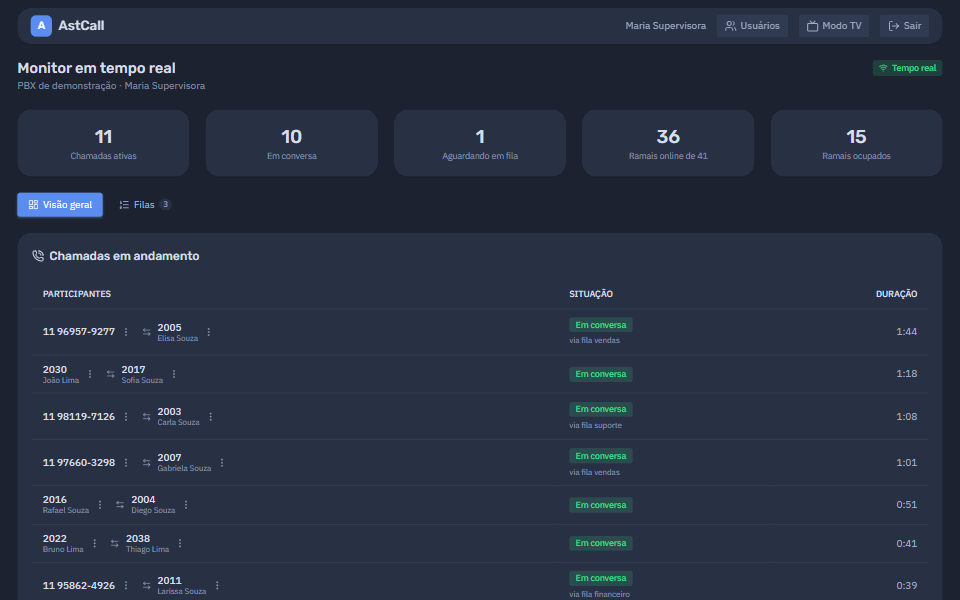
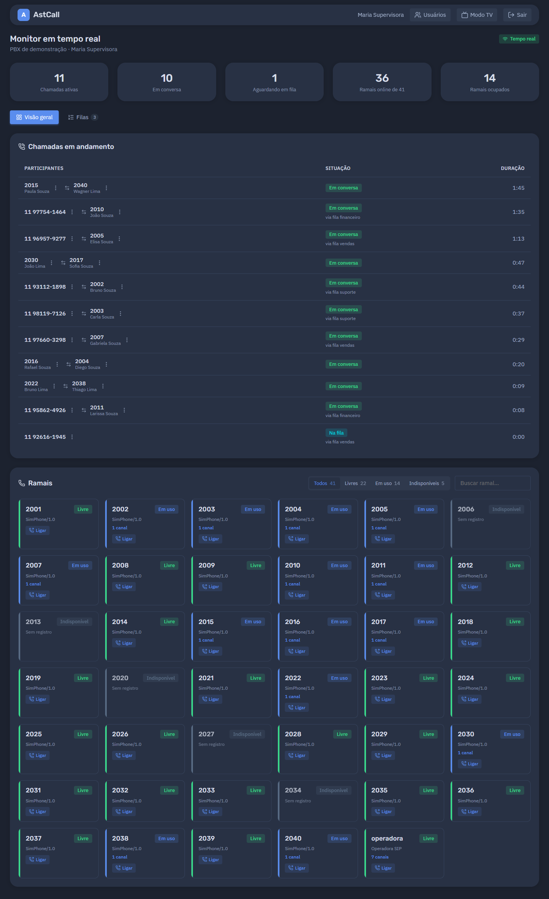
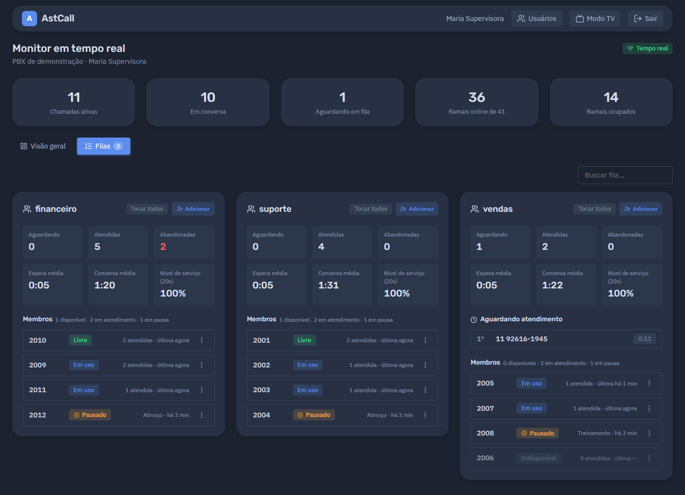
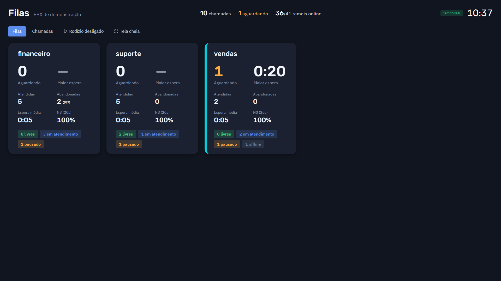
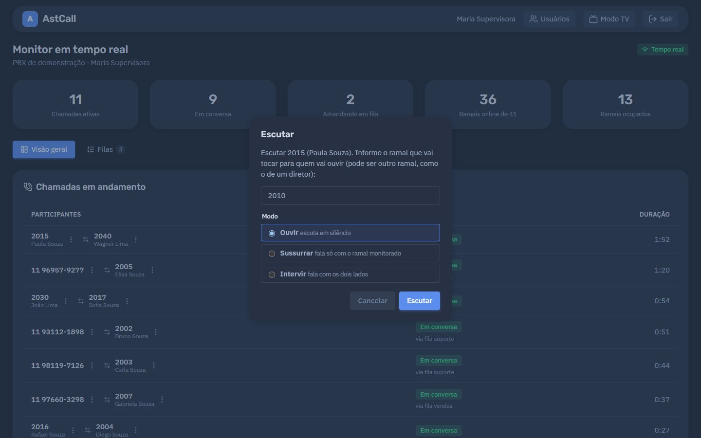
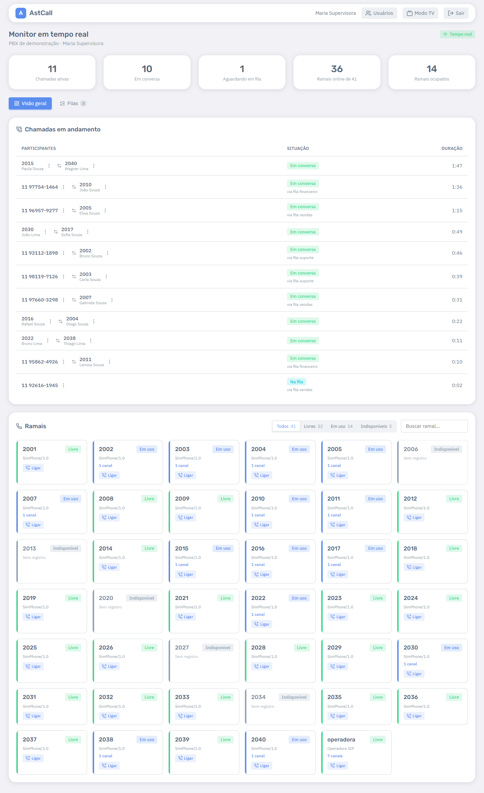

# AstCall — monitor em tempo real para Asterisk

[](LICENSE)


[](https://github.com/isoazevedo/AstCall/discussions/1)

**Painel de monitoramento em tempo real para Asterisk 20 e 22.** Mostra ramais, chamadas e filas
no instante em que acontecem e permite agir sobre elas — desligar, transferir, escutar, pausar
atendentes — direto do navegador. Uma alternativa moderna ao MonAst, com PJSIP, filas, modo TV
(wallboard) e multiempresa.

Funciona sozinho (**standalone**, com login próprio) ou como **módulo do AzCall**, usando o login e
as permissões de cada empresa.



> **Está testando? Sua opinião vale muito.** Conte o que achou, o que faltou ou o que poderia ser
> mais fácil no [tópico de feedback](https://github.com/isoazevedo/AstCall/discussions/1), ou
> [abra uma issue](https://github.com/isoazevedo/AstCall/issues/new/choose) se algo não funcionar.

<details>
<summary><b>English</b></summary>

**AstCall is a real-time monitoring panel for Asterisk 20 and 22** — a modern take on MonAst.
It shows PJSIP endpoints, live calls (transfers and queue calls correlated into a single call) and
queues (waiting callers, service level, agents) the moment they change, over AMI and WebSocket.
Supervisors can hang up, transfer, listen/whisper/barge (ChanSpy), and pause or add queue members,
each action checked against per-user permissions and audited. It also has a TV wallboard mode,
embeddable Web Components and multi-tenant scoping.

Stack: Node.js + TypeScript backend (own AMI client, in-memory state), Vue 3 Web Components.
Runs standalone (own login) or embedded in a PHP system. Try it without an Asterisk server with
`npm run demo`. The documentation is in Portuguese; feedback in English is welcome in
[Discussions](https://github.com/isoazevedo/AstCall/discussions).

</details>



## O que ele faz

- **Chamadas em andamento**: quem fala com quem, há quanto tempo, por qual fila, se está sendo
  gravada ou escutada. Transferências e consultas aparecem como uma chamada só.
- **Ramais**: situação de cada ramal (livre, em uso, tocando, em espera, indisponível), com o
  telefone registrado.
- **Filas**: quem está aguardando e há quanto tempo (com alerta de espera longa), atendidas,
  abandonadas, nível de serviço e a situação de cada atendente.
- **Ações** (conforme a permissão de cada usuário):
  - ligar a partir de um ramal, desligar e transferir chamadas;
  - **escutar, sussurrar ou intervir** numa conversa (pelo ramal que você escolher);
  - pausar/retomar atendentes, adicionar/remover membros de fila e alterar a penalidade.
- **Modo TV**: tela escura e em letras grandes para a TV da operação, alternando filas e chamadas.
- **Widgets**: partes do painel (filas, ramais, chamadas) para montar telas sob medida.
- **Multiempresa** (no AzCall): cada empresa vê só os próprios ramais, filas e chamadas.
- **Auditoria**: toda ação feita pelo painel fica registrada (quem, quando, o quê, resultado).

| Filas                                     | Modo TV                                  |
| ----------------------------------------- | ---------------------------------------- |
|           |         |
| **Escuta de uma chamada**                 | **Tema claro**                           |
|  |  |

> Os prints usam o PBX de demonstração: nomes e números são fictícios.

## Escolha o seu caminho

| Você quer…                                  | Leia                                                            |
| ------------------------------------------- | --------------------------------------------------------------- |
| Usar o painel (supervisores e operadores)   | [Guia de uso](docs/guias/uso-do-painel.md)                      |
| Experimentar sem ter um Asterisk            | [Demonstração e testes](docs/guias/demonstracao-e-testes.md)    |
| Instalar num servidor próprio (standalone)  | [Instalação standalone](docs/guias/instalacao-standalone.md)    |
| Ativar como módulo do AzCall                | [Instalação no AzCall](docs/guias/instalacao-azcall.md)         |
| Preparar o Asterisk (usuário AMI e filtros) | [Configuração do Asterisk](docs/guias/configuracao-asterisk.md) |
| Montar telas com filas, ramais ou chamadas  | [Widgets](docs/guias/widgets.md)                                |

Documentação técnica: [contrato com o AzCall](docs/INTEGRACAO_AZCALL.md) ·
[manager.conf detalhado](docs/manager.conf.md) · [auditoria](docs/AUDITORIA.md) ·
[testes de carga](docs/CARGA.md) · [roadmap](docs/ROADMAP.md).

## Como funciona

```
Asterisk ──AMI──► backend AstCall (Node.js) ──WebSocket──► navegador (painel Vue)
                  estado em memória, ações,       snapshot inicial + atualizações
                  permissões, auditoria
```

O navegador **nunca** fala com o Asterisk: todas as ações passam pelo backend, que confere a
permissão do usuário antes de executar. O usuário AMI do AstCall não tem acesso a comandos de CLI.

## Desenvolvimento

Requisitos: Node.js 22 ou superior.

```bash
npm install
cp .env.example .env                               # ajuste as credenciais AMI
cp config/servers.example.json config/servers.json
npm run keys:generate                              # chaves do login standalone
npm run user add admin                             # pergunta nome, permissões e senha
npm run dev:realtime                               # backend (porta 8090)
npm run dev:web                                    # painel em http://localhost:5173
```

Sem Asterisk por perto, troque o `dev:realtime` por `npm run demo` (PBX simulado).

| Comando               | O que faz                                               |
| --------------------- | ------------------------------------------------------- |
| `npm test`            | Testes (Vitest), incluindo o replay das gravações reais |
| `npm run typecheck`   | Verifica os tipos em todos os pacotes                   |
| `npm run lint`        | ESLint em todo o repositório                            |
| `npm run format`      | Formata com Prettier                                    |
| `npm run build`       | Gera o `dist/` de shared, backend e painel              |
| `npm run demo`        | PBX simulado + backend, sem Asterisk                    |
| `npm run load-test`   | Teste de carga com PBX e navegadores simulados          |
| `npm run screenshots` | Refaz os prints da documentação (com o `demo` rodando)  |
| `npm run user …`      | Usuários do standalone pela linha de comando            |
| `npm run audit …`     | Consulta o log de auditoria                             |

Estrutura:

```
apps/realtime/   backend Node.js (AMI, estado, WebSocket, ações, autenticação)
apps/web/        painel Vue 3: Web Components + SPA standalone (login + painel)
packages/shared/ tipos e contratos compartilhados
config/          lista de servidores Asterisk (exemplo e demonstração)
docs/            guias, contratos e roadmap
```
