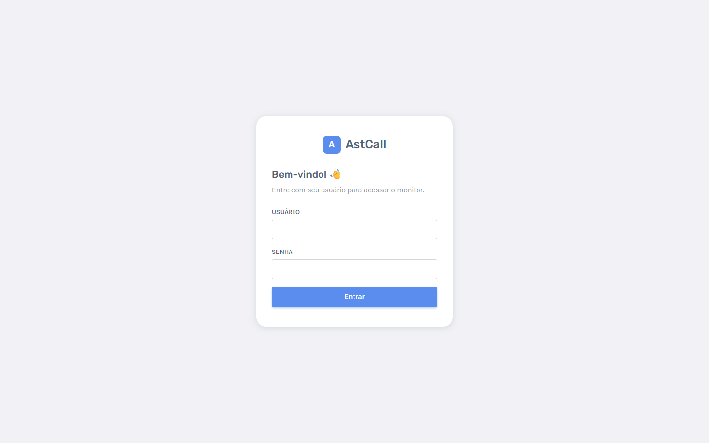
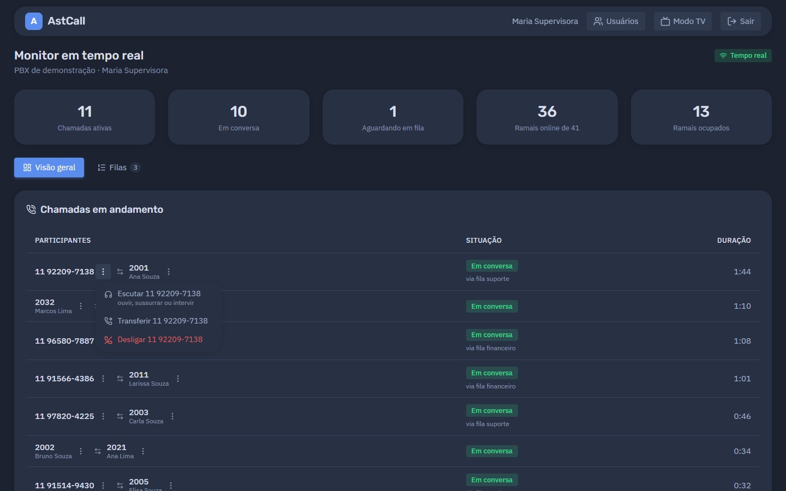
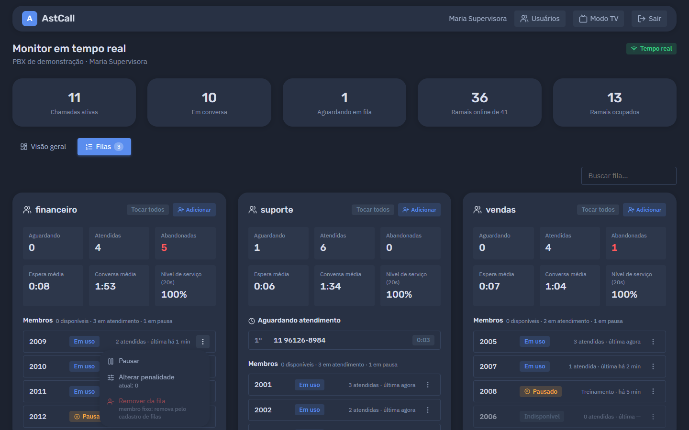
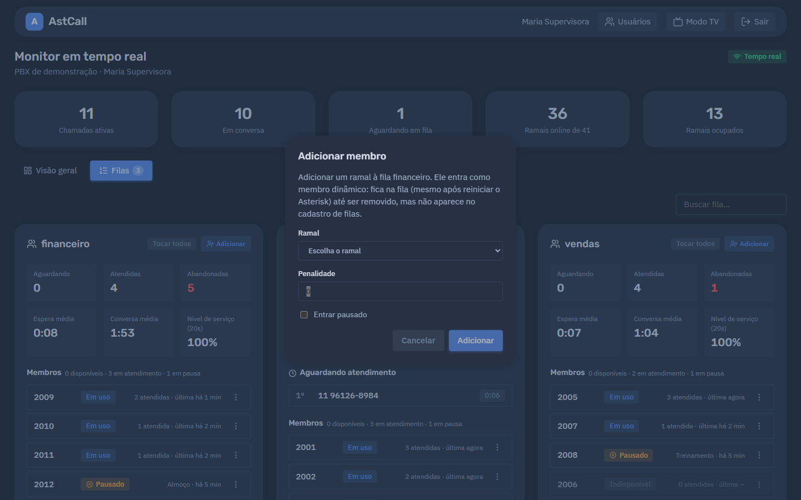
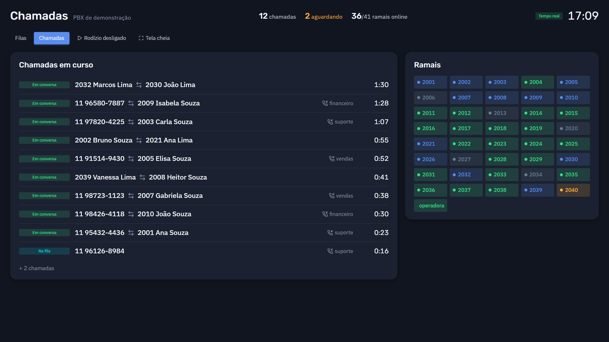
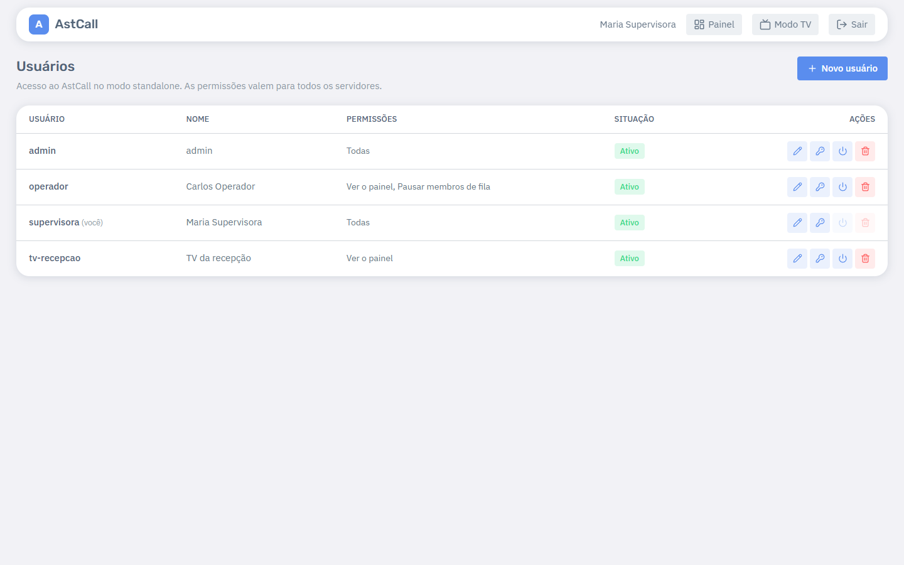

# Guia de uso do painel

> Para supervisores e operadores. Não precisa saber nada de servidor ou de Asterisk.
> Os prints usam o PBX de demonstração: nomes e números são fictícios.

O AstCall mostra, em tempo real, o que está acontecendo no seu PBX: quem está falando com quem,
quais ramais estão livres e como estão as filas de atendimento. Nada precisa ser atualizado: a
tela muda sozinha no instante em que algo acontece.

## Entrando

- **No AzCall:** menu **Monitoramento → AstCall**. Não há segundo login: vale o seu usuário do
  AzCall, e você vê só os ramais, filas e chamadas da sua empresa.
- **No AstCall standalone:** abra o endereço informado pelo administrador e entre com o usuário
  e a senha que ele criou para você.

O selo no canto superior direito mostra a conexão: **Tempo real** (tudo certo), **Sincronizando**
(o painel está buscando o estado completo, leva poucos segundos), **PBX desconectado** ou
**Sessão expirada** (entre novamente).

## Visão geral

No topo, os números do momento: chamadas ativas, em conversa, aguardando em fila, ramais online e
ramais ocupados.

### Chamadas em andamento

Cada linha é uma chamada, com os participantes (número e nome), a situação e a duração:

| Situação        | O que significa                                                        |
| --------------- | ---------------------------------------------------------------------- |
| **Discando**    | o ramal está discando                                                  |
| **Tocando**     | o destino está tocando (pisca)                                         |
| **Na fila**     | o cliente está aguardando numa fila                                    |
| **Em conversa** | as duas pontas estão falando — a duração conta a partir do atendimento |
| **Em espera**   | alguém colocou a chamada em espera                                     |

Indicações extras: **via fila X** (a chamada entrou por uma fila), **REC** (está sendo gravada) e
**Em escuta** (um supervisor está ouvindo). Transferências e consultas continuam aparecendo como
**uma chamada só**, com quem está falando agora.

### Ações de uma chamada — menu ⋮

Ao lado de cada participante há um botão **⋮** com as ações sobre aquele lado da chamada:

- **Escutar** — o ramal que você informar toca; ao atender, você entra na chamada em um de três
  modos:
  - **Ouvir**: escuta em silêncio;
  - **Sussurrar**: fala só com o seu atendente (o cliente não ouve);
  - **Intervir**: fala com os dois lados.

  O ramal que vai tocar pode ser qualquer um — por exemplo, o de um diretor que quer ouvir uma
  ligação. O painel lembra o último ramal usado.

  

- **Transferir** — leva esse participante para outro número ou ramal (transferência direta).
- **Desligar** — encerra a chamada desse participante (pede confirmação).

Só aparecem as ações que o seu usuário tem permissão de usar e que fazem sentido no momento (por
exemplo, escutar e transferir só com a chamada em conversa).

### Ramais

Cada cartão mostra o ramal, a situação (**Livre**, **Em uso**, **Ocupado**, **Tocando**, **Em
espera**, **Indisponível**) e o aparelho registrado. Use os filtros **Todos / Livres / Em uso /
Indisponíveis** e a busca para encontrar um ramal.

O botão **Ligar** faz o ramal tocar; quando a pessoa atende, o painel liga para o número que você
informou — útil para retornar uma ligação pelo ramal certo.

## Filas

Cada fila mostra:

- **Aguardando**, com a lista de clientes na ordem de atendimento e o tempo de espera de cada um.
  A espera fica **amarela a partir de 1 minuto** e **vermelha a partir de 3 minutos**;
- **Atendidas**, **Abandonadas**, **Espera média**, **Conversa média** e o **Nível de serviço**
  (porcentagem atendida dentro do tempo configurado na fila);
- **Membros** (atendentes): disponíveis, em atendimento, em pausa (com o motivo e há quanto
  tempo) e indisponíveis. Membros marcados como **dinâmico** foram adicionados pelo painel e não
  fazem parte do cadastro da fila.

### Ações de um membro — menu ⋮

- **Pausar / Retomar** — com motivo opcional (ex.: "Almoço") e a opção de aplicar em **todas as
  filas** do atendente.
- **Alterar penalidade** — quanto maior a penalidade, mais tarde o atendente recebe chamadas
  (0 = recebe primeiro). Em membros do cadastro, a penalidade volta ao valor original quando as
  filas são recarregadas.
- **Remover da fila** — só para membros **dinâmicos**. Membros do cadastro saem pelo cadastro de
  filas (no AzCall) ou podem ser pausados.

### Adicionar um atendente

O botão **Adicionar** no cartão da fila coloca um ramal na fila na hora — por exemplo, para
reforçar o atendimento num pico. Escolha o ramal, a penalidade e se ele já entra pausado.

O ramal entra como **dinâmico**: continua na fila (inclusive depois de reiniciar o PBX) até ser
removido pelo painel.

## Modo TV

Para deixar numa TV da operação: tela escura, letras grandes e nenhuma ação.

- **No AzCall:** botão **Modo TV** na página do AstCall (abre em nova aba).
- **No standalone:** botão **Modo TV** na barra superior.

| Filas                                  | Chamadas e ramais                            |
| -------------------------------------- | -------------------------------------------- |
|  |  |

- **Rodízio:** alterna entre Filas e Chamadas a cada 15 segundos. O botão **Rodízio
  ligado/desligado** fixa a tela atual; a escolha fica salva no navegador da TV.
- **Tela cheia:** botão **Tela cheia** (o navegador pede um clique).
- Os botões somem quando o mouse fica parado e voltam ao mexer.
- Na tela de filas, uma faixa colorida à esquerda destaca a fila com espera longa.

## Permissões

O que cada pessoa pode fazer é definido pelo administrador (no AzCall: **Funções & Permissões**;
no standalone: tela **Usuários**). Sem permissão, o botão simplesmente não aparece — e o servidor
também recusa.

| Permissão (AzCall)     | Permissão (standalone)            | Libera                                         |
| ---------------------- | --------------------------------- | ---------------------------------------------- |
| `astcall.view`         | Ver o painel                      | ver o painel e o modo TV                       |
| `astcall.originate`    | Ligar a partir de um ramal        | botão **Ligar** dos ramais                     |
| `astcall.hangup`       | Desligar chamadas                 | **Desligar**                                   |
| `astcall.transfer`     | Transferir chamadas               | **Transferir**                                 |
| `astcall.spy`          | Escutar / sussurrar / intervir    | **Escutar**                                    |
| `astcall.queue`        | Pausar membros de fila            | **Pausar / Retomar**                           |
| `astcall.queue_manage` | Adicionar/remover membros de fila | **Adicionar**, **Remover da fila**, penalidade |
| —                      | Gerenciar usuários                | tela **Usuários** (só no standalone)           |

Mudanças de permissão valem em até 10 minutos (na próxima renovação automática do acesso) ou ao
entrar novamente.

## Usuários (standalone)

Quem tem a permissão **Gerenciar usuários** vê o link **Usuários** na barra superior: cria
usuários, ajusta permissões, troca senhas, desativa e remove.

- A senha tem no mínimo 10 caracteres.
- Trocar a senha ou desativar um usuário encerra na hora as sessões abertas dele.
- Ninguém consegue desativar ou remover a si mesmo, e sempre sobra ao menos um administrador.

## Dúvidas frequentes

**Uma chamada que já terminou continua aparecendo.** O painel confere o estado com o PBX a cada
minuto e remove o que sobrou; se persistir, recarregue a página.

**Não vejo um ramal ou uma fila.** No AzCall, você vê só o que é da sua empresa. Confira também os
filtros e a busca.

**O botão de uma ação não aparece.** Falta a permissão correspondente (tabela acima) ou a ação não
se aplica à situação da chamada.

**"Sessão expirada".** Entre novamente. No AzCall, a página volta sozinha para o login.

**Toda ação fica registrada?** Sim: quem fez, quando, o quê e o resultado ficam no log de
auditoria do servidor.
