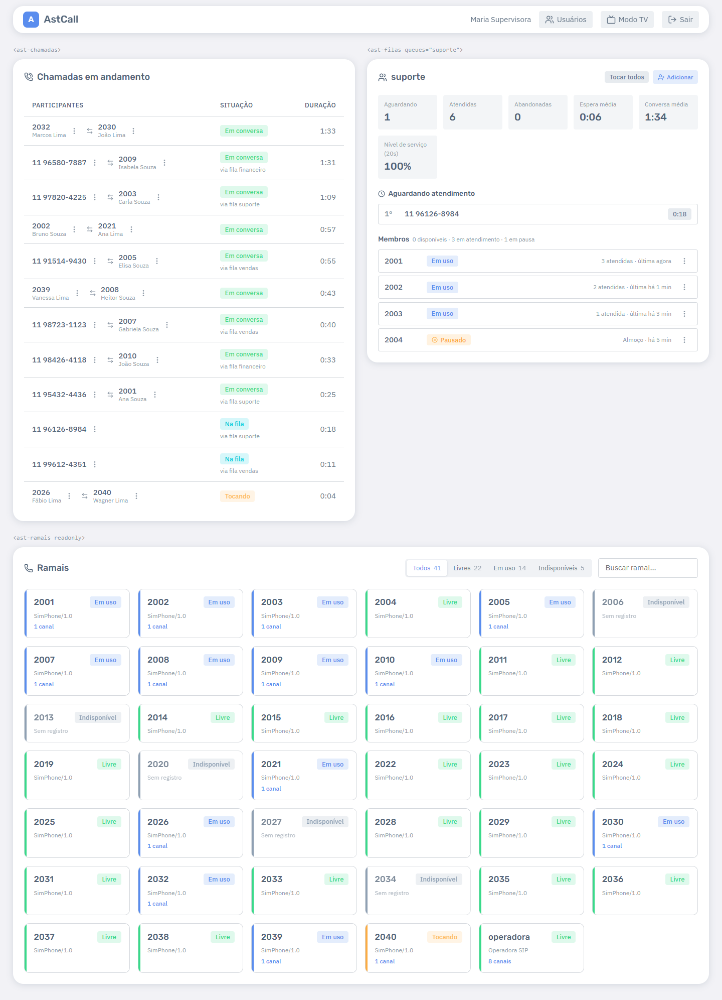

# Widgets: telas sob medida

> Para quem monta páginas (no AzCall ou em qualquer site interno). Referência completa dos
> atributos: [contrato de integração, seção 1.5](../INTEGRACAO_AZCALL.md#15-widgets-ast-filas-ast-ramais-ast-chamadas).

Além do painel completo (`<ast-monitor>`), o AstCall oferece partes dele como elementos HTML
próprios. Com eles dá para montar, por exemplo, um dashboard só com as filas do suporte ou uma
página da recepção só com os ramais.



## Os elementos

| Elemento         | Mostra                       | Atributo próprio (opcional)                |
| ---------------- | ---------------------------- | ------------------------------------------ |
| `<ast-monitor>`  | painel completo (ou modo TV) | `mode="tv"`, `rotate="15"`                 |
| `<ast-filas>`    | cartões das filas            | `queues="suporte,vendas"` — só essas filas |
| `<ast-ramais>`   | ramais com filtros e busca   | `endpoints="2001,2002"` — só esses ramais  |
| `<ast-chamadas>` | chamadas em andamento        | —                                          |

Todos aceitam:

- `ws-url` e `token-url` — endereços da conexão (no AzCall: `/astcall/monitor-ws` e
  `/astcall/token`);
- `readonly` — só visualização, sem nenhuma ação.

## Exemplo

```html
<script type="module" src="/astcall/static/ast-monitor.js"></script>

<h3>Filas do suporte</h3>
<ast-filas ws-url="/astcall/monitor-ws" token-url="/astcall/token" queues="suporte"></ast-filas>

<h3>Ligações agora</h3>
<ast-chamadas ws-url="/astcall/monitor-ws" token-url="/astcall/token" readonly></ast-chamadas>
```

## Bom saber

- **Uma conexão por página:** vários widgets na mesma página compartilham a mesma conexão com o
  servidor — não pesa usar vários.
- **Permissões e empresa:** iguais às do painel. Os filtros `queues`/`endpoints` só **restringem**
  o que o usuário já pode ver; nunca dão acesso a mais.
- **Ações:** seguem as permissões do usuário; o diálogo aparece no widget onde a ação foi
  pedida. Com `readonly`, nenhuma ação aparece.
- **Aparência:** os widgets usam as cores e fontes da página (tema do AzCall). No modo escuro,
  defina a cor do cartão também para eles:

  ```css
  .dark-style ast-filas,
  .dark-style ast-ramais,
  .dark-style ast-chamadas {
    --ast-card-bg: #283144;
  }
  ```

- **Sessão expirada:** cada widget dispara o evento `auth-required`; a página decide o que fazer
  (ex.: voltar ao login).

Para ver os widgets funcionando sem montar nada: no modo standalone, abra
`/?widgets` (ou `/?widgets=suporte` para filtrar a fila) — veja
[Demonstração e testes](demonstracao-e-testes.md).
